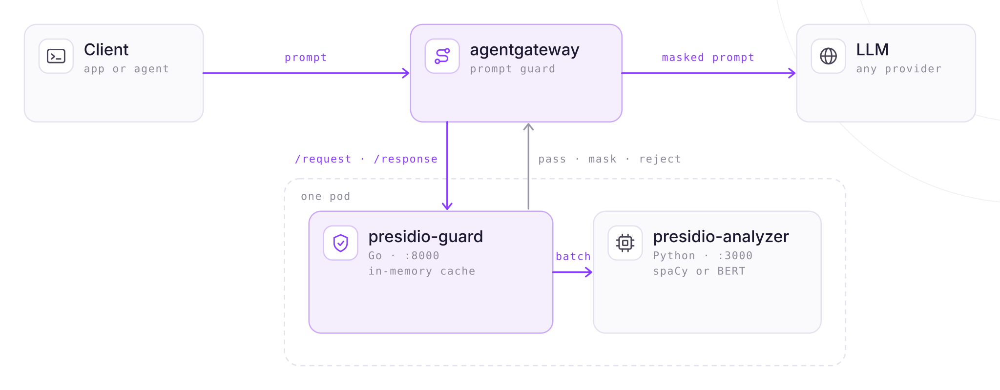

# agentgateway-presidio

A guardrail webhook that puts [Presidio](https://github.com/data-privacy-stack/presidio)
PII detection in front of every LLM call that goes through
[agentgateway](https://agentgateway.dev).

agentgateway's prompt guard calls a webhook before the prompt reaches the LLM
(`POST /request`) and before the completion reaches the client
(`POST /response`). This service implements that
[Guardrail Webhook API](https://agentgateway.dev/docs/kubernetes/latest/documentation/llm/guardrails/webhook/)
in Go and asks a `presidio-analyzer` sidecar what is in each message. Then it
answers with one of three actions:

- **pass**: nothing found.
- **mask**: the same messages, with each finding replaced by its type
  (`Call <PERSON> at <PHONE_NUMBER>`).
- **reject**: the prompt holds an entity listed in `REJECT_ENTITIES` (for
  example a credit card number), and the client gets a 403. The LLM is never
  called.



All of a request's messages go to the analyzer in one batch call. The guard
masks the text itself, so there is no call to `presidio-anonymizer`.

## Configuration

| Variable | Default | |
|---|---|---|
| `PRESIDIO_URL` | `http://127.0.0.1:3000` | presidio-analyzer |
| `ENTITIES` | every entity | Presidio entity types to act on, comma separated |
| `REJECT_ENTITIES` | none | Types that reject the request instead of masking it (`/request` only; responses are always masked) |
| `SCORE_THRESHOLD` | `0.5` | Minimum Presidio confidence |
| `LANGUAGE` | `en` | |
| `REJECT_STATUS` | `403` | HTTP status of a rejection |
| `PRESIDIO_TIMEOUT` | `5s` | Per analyzer call. agentgateway gives the webhook 10 s |
| `LISTEN` | `:8000` | |
| `CACHE_SIZE` | `50000` | Messages kept in the in-memory findings cache. `0`: no cache |
| `CACHE_TTL` | `1h` | How long a cached entry lives |

The log line of each call has the entities found, the cache hits and misses,
and the guard's own time in milliseconds.

## Findings cache

agentgateway sends the whole conversation to the webhook on every turn, and
the guard has to check all of it: the client keeps the original, unmasked
text of earlier turns and sends it again. Without a cache each turn analyzes
all earlier turns again. The guard keeps the analyzer's findings per message
text in memory:

- **Key**: the SHA-256 of the message text. **Value**: the findings (entity
  type, offsets, score). The text and the masked text are not stored.
- **Per call**: identical texts are looked up once; the misses go to the
  analyzer in one batch and are stored. Masking runs on the cached offsets,
  so the output is the same as without the cache.
- **LRU with a TTL**: at most `CACHE_SIZE` messages, each for `CACHE_TTL`.
  An entry is a few hundred bytes, so the default 50,000 entries stay around
  15 MB.
- **Per pod, on purpose**: a miss only costs an analyzer call, never a wrong
  answer, so a cache shared between replicas would buy hit rate, not
  correctness. In memory there is nothing to deploy, no network hop, and no
  PII metadata leaves the pod. The cache lives as long as the configuration
  and the analyzer sidecar it was filled with, so it never needs versioning.
  With several replicas, turns of one conversation that land on different
  pods miss once per pod.

## Deploy

Every release pushes the image for linux/amd64 and linux/arm64 to
`ghcr.io/paurosello/presidio-guard`, and `deploy/presidio-guard.yaml` points
at the latest one:

```sh
kubectl apply -f deploy/presidio-guard.yaml
kubectl apply -f deploy/policy.yaml   # attaches the guard to the HTTPRoute "llm"
```

To build it yourself, `docker build -t <registry>/presidio-guard .` and set
that image in the manifest.

`deploy/policy.yaml` is an `AgentgatewayPolicy` with two request guards and
one response guard. Request guards run in the order listed, each on the
previous one's output: agentgateway's regex guard masks the formatted values
(SSNs, credit cards, emails, phone numbers), then this webhook masks what has
no pattern, such as names and addresses. Because the regex guard has already
masked cards and SSNs, `REJECT_ENTITIES` no longer fires for them; to reject
those requests, use a regex guard with `action: Reject` for the `Ssn` and
`CreditCard` builtins instead.

The webhook's `failureMode` is unset, so it defaults to `FailClosed`: if the
guard is down, requests are rejected instead of being sent unchecked.

The analyzer is the official `ghcr.io/data-privacy-stack/presidio-analyzer`
image with spaCy's `en_core_web_lg`. It is CPU bound: give it one gunicorn
`WORKERS` per CPU, and scale out with replicas.

### Another NER model

The guard doesn't depend on the analyzer's model. To trade speed for recall,
run Presidio's stock `transformers` NLP configuration with
`StanfordAIMI/stanford-deidentifier-base`. The official image lacks the
`transformers` extra and the small spaCy pipeline that configuration uses for
tokenizing, so build one:

```dockerfile
FROM ghcr.io/data-privacy-stack/presidio-analyzer:2.2.366
USER root
RUN pip install --no-cache-dir "presidio-analyzer[transformers]==2.2.366" \
 && python -m spacy download en_core_web_sm
USER 1001
```

pip installs the CUDA build of torch, so the image is about 10 GB. For CPU
only, install `torch` from `https://download.pytorch.org/whl/cpu` first.

Mount Presidio's
[`transformers.yaml`](https://github.com/data-privacy-stack/presidio/blob/main/presidio-analyzer/presidio_analyzer/conf/transformers.yaml)
into the analyzer and set `NLP_CONF_FILE` to its path. The model is
downloaded on first start. On CPU it handles a few documents a second; on a
GPU, add CuPy to the image and set `PRESIDIO_DEVICE=cuda`.

### Sizing and probes

- Each gunicorn worker loads its own copy of the spaCy model: about 750 MB
  with `en_core_web_lg`. A rolling update briefly doubles that; budget for it
  or use `maxSurge: 0`.
- The analyzer costs about 11 ms of CPU per 1,000 characters analyzed, and
  agentgateway sends the whole conversation on every turn.
- The guard's `/healthz` checks the analyzer only until it has answered once.
  Under load the analyzer's `/health` waits behind the analyze calls; a probe
  that depends on it takes the pod out of the Service, and agentgateway then
  fails every request closed.
